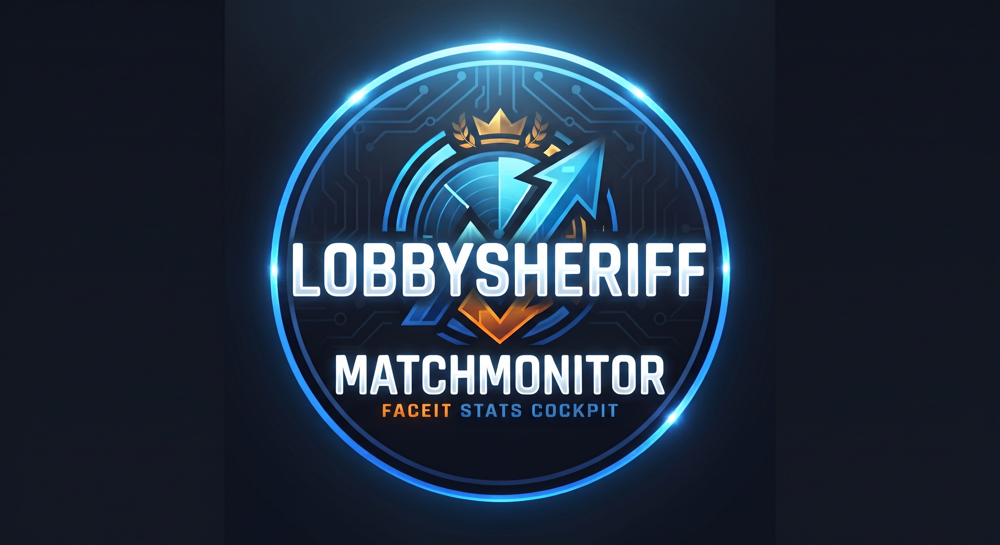

<p align="center">
  
</p>

<h1 align="center">LobbySheriff</h1>

<p align="center">
  <strong>FACEIT Stats Cockpit</strong> — acompanha a evolução de grupos de amigos no CS2 através da FACEIT Data API, com rankings comparativos e a eleição semanal do <strong>LobbySheriff da Semana</strong>.
</p>

<p align="center">
  <a href="https://github.com/pgalocha/lobbysheriff/actions/workflows/go-stats-api.yml"></a>
  <a href="https://github.com/pgalocha/lobbysheriff/actions/workflows/contracts.yml"></a>
</p>

> 🚧 Projeto em desenvolvimento ativo. Fase atual: **Fase 1 — serviço de estatísticas em Go**.

---

## ✨ O que faz

- **Lobbies** — cada grupo de amigos tem o seu próprio *cockpit*, com ranking e estatísticas filtradas pelos seus membros.
- **Estatísticas e histórico** — evolução de Elo/Level, K/D, ADR, HS% e Win Rate ao longo do tempo.
- **LobbySheriff da Semana** — o jogador em destaque de cada lobby, calculado a partir das partidas da semana.
- **Sincronização inteligente** — recolha periódica dos dados da FACEIT, com deteção de alterações (*se for igual, não atualiza*) e ingestão desduplicada: um jogador presente em vários lobbies é consultado uma única vez.

## 🏗️ Arquitetura

Monorepo com microsserviços, cada um dono do seu domínio e da sua base de dados (*Database per Service*):

| Serviço | Stack | Responsabilidade |
|---|---|---|
| `go-stats-api` | Go + Fiber | Sincronização com a FACEIT, snapshots, partidas, rankings e Jogador da Semana |
| `php-players-api` | PHP (Symfony/Laravel) | Gestão de lobbies, jogadores e associações; endpoints internos para o Go |
| `frontend` | Vue 3 + TypeScript + Vite | Cockpit, rankings e gráficos comparativos |
| `gateway` | Nginx | Reverse proxy, rate limiting e security headers |

**Infraestrutura:** MySQL (schemas separados por serviço), Redis (cache-aside, change detection e distributed locks), Prometheus + Grafana e Sentry para observabilidade, e GitHub Actions para CI.

```
Vue.js ──► Nginx Gateway ──► go-stats-api ──► FACEIT Data API v4
                         └─► php-players-api
                                  │
                         MySQL  ·  Redis
```

## 🧰 Tech stack

<table>
  <tr>
    <td><strong>Backend</strong></td>
    <td>
      
      
      
    </td>
  </tr>
  <tr>
    <td><strong>Frontend</strong></td>
    <td>
      
      
      
    </td>
  </tr>
  <tr>
    <td><strong>Dados</strong></td>
    <td>
      
      
    </td>
  </tr>
  <tr>
    <td><strong>API</strong></td>
    <td>
      
      
      
    </td>
  </tr>
  <tr>
    <td><strong>Infraestrutura</strong></td>
    <td>
      
      
      
      
    </td>
  </tr>
  <tr>
    <td><strong>CI/CD</strong></td>
    <td>
      
      
      
    </td>
  </tr>
  <tr>
    <td><strong>Observabilidade</strong></td>
    <td>
      
      
      
    </td>
  </tr>
</table>

## 📁 Estrutura

```
lobbysheriff/
├── .devcontainer/         # Ambiente de desenvolvimento (Dev Container)
├── .github/workflows/     # CI por serviço
├── contracts/openapi/     # Contratos HTTP (OpenAPI) — fonte de verdade das APIs
├── gateway/               # Configuração Nginx
├── infra/                 # Infraestrutura local (init do MySQL, …)
├── observability/         # Prometheus e Grafana
├── postman/               # Coleções Postman geradas a partir dos contratos
├── scripts/               # Tarefas do repositório (contratos, …)
├── services/
│   ├── go-stats-api/      # Microsserviço Go + Fiber
│   └── php-players-api/   # Microsserviço PHP
├── frontend/              # Vue 3 + TypeScript
└── docker-compose.yml
```

## 🚀 Começar

### Pré-requisitos

- Git e Docker (com Docker Compose)
- VS Code com a extensão [Dev Containers](https://marketplace.visualstudio.com/items?itemName=ms-vscode-remote.remote-containers)
- Uma **API Key server-side** da FACEIT ([developers.faceit.com](https://developers.faceit.com/))

Não é preciso instalar Go nem outras ferramentas no host: o Dev Container traz Go 1.27,
golangci-lint, [golang-migrate](https://github.com/golang-migrate/migrate), kubectl, gh e
os clientes MySQL/Redis.

### Configuração

```bash
git clone git@github.com:pgalocha/lobbysheriff.git
cd lobbysheriff
cp .env.example .env   # define FACEIT_API_KEY e restantes variáveis
code .                 # e depois: "Dev Containers: Reopen in Container"
```

O Dev Container arranca automaticamente o MySQL (um schema e um utilizador por serviço) e o
Redis, na mesma rede (`mysql:3306`, `redis:6379`). Para correr tudo em containers, sem o
editor:

```bash
docker compose up -d --build
curl localhost:8080/health
```

| URL | O quê |
|---|---|
| http://localhost:8080/health | `go-stats-api`: estado das dependências |
| http://localhost:8090 | Swagger UI com os contratos das APIs |

### Contratos de API

As APIs são *contract-first*: o contrato OpenAPI em `contracts/openapi/` é escrito primeiro e
o código, a validação, o Swagger e o Postman derivam dele. Ver
[contracts/README.md](contracts/README.md).

> ⚠️ A `FACEIT_API_KEY` é usada apenas no backend e nunca deve ser exposta ao frontend nem commitada.

## 🗺️ Roadmap

- [ ] **Fase 1** — `go-stats-api`: cliente FACEIT, sincronização, cache Redis e cálculo do Jogador da Semana
- [ ] **Fase 2** — `php-players-api`: gestão de lobbies e jogadores, endpoints internos e contratos OpenAPI
- [ ] **Fase 3** — Segurança, gateway Nginx, redes Docker isoladas, observabilidade e CI/CD
- [ ] **Fase 4** — Frontend em Vue 3 com rankings e gráficos comparativos

## 📚 Referências

- [FACEIT Data API v4 — Documentação](https://docs.faceit.com/)
- [FACEIT Developers Portal](https://developers.faceit.com/)

## 📄 Licença

© 2026 Pedro Galocha. Todos os direitos reservados.

O código está publicamente visível apenas para consulta. Não é concedida qualquer licença de utilização, cópia, modificação ou distribuição — ver [LICENSE](LICENSE).